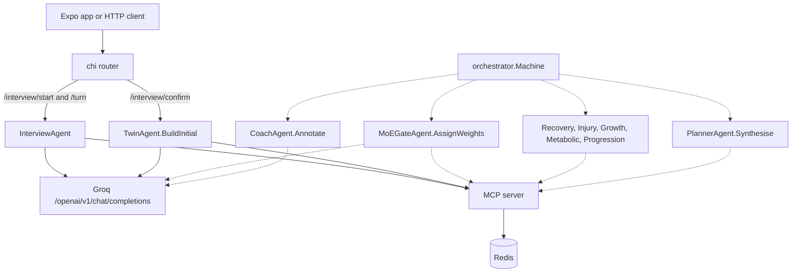

# TRACE

TRACE (Training Response & Adaptation Causal Engine) is a Go HTTP API and an Expo client that store a per-person training profile and causal graph in Redis. A mixture-of-experts (MoE) gate is sketched to weight specialist agents when building a workout. That gate, the specialist agents, and the daily state machine are not executable yet.

## Problem it solves

A fixed program ignores what has already helped or hurt one person: injuries, programs that stalled, sleep, and stress. TRACE's model for that history is a versioned causal graph (exercises, patterns, states, outcomes, and directed edges with a confidence and a polarity). The intended daily loop reads the graph, asks a gate for weights, runs specialist agents, and writes a workout plan that cites the graph.

What runs today is narrower. `POST /api/v1/interview/start` opens an in-memory interview. `POST /api/v1/interview/turn` sends the transcript to Groq and stores extracted profile fields on the session. `POST /api/v1/interview/confirm` writes the profile through the MCP server (AES-256-GCM in Redis) and asks `TwinAgent.BuildInitial` to seed a graph. Workout generation, post-workout logging, and the MoE gate do not complete a request.

This checkout is 5,111 lines of Go (`*.go`, excluding `mobile/`) plus an Expo app under `mobile/`.

## Architecture

Agents depend on `ports.MCPClient` and, when they need a model, `ports.LLMClient`. They do not take a Redis client. `internal/infrastructure/mcp.Server` is the only implementation of that data port. `cmd/server/main.go` constructs a Groq client and passes it to the interview agent, the twin, the MoE gate, the coach, and the log agent. A Gemini client exists in `internal/infrastructure/gemini` and is not constructed in `main`.

Solid arrows are the HTTP path that completed requests in the run recorded below. Dashed arrows are wired in `main` or written as transition data, and the methods they reach panic with `not implemented` or are never called by a handler.



`main` builds `OnboardingOrchestrator` and `DailyLoopOrchestrator`, merges their handler maps, and calls `orchestrator.NewMachine`. The returned machine is discarded. Interview HTTP handlers call `InterviewAgent` and `TwinAgent` directly.

### State table

`internal/application/orchestrator/state.go` holds the transition table. `Machine.transition` can look up a row. `StartSession`, `Send`, and `CurrentState` panic.

Onboarding, as written in the table:

`NEW_USER` → `INTERVIEW_ACTIVE` → `INTERVIEW_COMPLETE` → `GRAPH_BUILD_INITIAL` → `FIRST_WORKOUT_GEN` → `AWAITING_LOG`

Daily loop, as written in the table:

`AWAITING_LOG` → `LOG_ACTIVE` → `LOG_COMPLETE` → `GRAPH_UPDATE` → `MOE_GATING` → `AGENTS_RUN` → (`VETO_RESOLVE` or straight to) `PLAN_SYNTH` → `COACH_WRITE` → `WORKOUT_READY` → `AWAITING_LOG`

Onboarding handlers panic. Daily-loop handlers panic except `HandleAgentsRun`, which calls `weightsFromSession` first. That helper panics, so the five goroutines below it do not start. The function is written to call recovery, growth, metabolic, progression, and injury together, then return `VETO_FIRED` when `ForceRestDay` is set or `VetoedExercises` is non-empty. Progression and injury are passed a nil exercise list; comments in the file say a finished version would wait for the growth report. `storeAgentReports` also panics.

### Agents

| Agent | Role in the types | What the method does |
| --- | --- | --- |
| Interview | Multi-turn onboarding, one combined JSON reply plus field extraction | Runs. Session map is in process memory. |
| Twin | Sole writer of the causal graph | `BuildInitial` runs. `Update` loads the graph and returns its version. |
| MoE gate | `WeightVector` over the five experts, intended to sum to 1 | `AssignWeights` panics. |
| Recovery | Recovery score, intensity cap, optional forced rest | `Evaluate` panics. |
| Injury | Veto, flag, or approve proposed exercises. Threshold constants are 0.70 and 0.50 | `Evaluate` panics. |
| Growth | Propose exercises from positive causal paths | `Evaluate` panics. |
| Metabolic | Conditioning and a calorie-deficit target | `Evaluate` panics. |
| Progression | Sets, reps, and load from history | `Evaluate` panics. |
| Planner | Apply vetoes, flags, progression, then MoE weights, and store a plan | `Synthesise` panics. |
| Coach | Fill `CausalReason` on each exercise | `Annotate` panics. |
| Log | Post-workout conversation into a `workout.Log` | Every method panics. HTTP log routes do not call it. |

`pkg/hmac` can sign and verify HMAC-SHA256. No live path signs an `A2AMessage`. `internal/infrastructure/messaging.Broker` panics on publish, subscribe, drain, and close. `internal/delivery/sse.Broker` panics on register, publish, and deregister. `GET /api/v1/workout/stream` sets SSE headers and then hits that panic. chi's `Recoverer` turned it into HTTP 500 and the process stayed up.

## Key design decisions

- **One data port.** Repository interfaces live in `internal/application/ports` and are used by the MCP server. Agent packages take `MCPClient`. `main` passes `nil` for the exercise-library repository and the conflict repository. `GetExerciseLibrary` ignores that field and returns a 15-exercise slice in `tools.go`. `LogVetoEvent` and `FlagConflict` return synthetic ids and do not write the veto repository that `main` does construct.
- **Profile encryption at the repository.** `UserRepository` encrypts the JSON profile with AES-256-GCM before `SET`. Graphs, logs, plans, progression lists, veto records, and chain-of-thought traces are stored as plaintext JSON. Graph `Save` writes the current key, a version key, and a snapshot key in one Redis transaction. It does not increment `Version`; `BuildInitial` sets `Version` to 1. Snapshot keys use a 90-day TTL in code.
- **Redis key prefix.** Keys are built in `internal/infrastructure/redis/keys.go` as `trace:{userID}:...`, plus `trace:cot:{id}` and `trace:veto:{id}`.
- **Interview completeness is local.** `isComplete` requires primary-goal confidence at least 0.65, days-per-week at least 0.60, and training-age and session-minutes at least 0.55. A reply that contains `[COMPLETE]` also marks that turn complete. The HTTP field summary marks a field filled at confidence 0.8 or above. Comments on the agent interface still say 0.8 for completion.
- **Demo authentication.** `POST /api/v1/auth/token` signs a 24-hour HS256 JWT for whatever `user_id` is in the body. There is no password check. Other `/api/v1` routes require `Authorization: Bearer`. The limiter increments `trace:{userID}:ratelimit` and allows the request when the count is at most 100 in the hour. A Redis error on that increment allows the request. `AuthConfig.MaxSessions` is 3 and is not read.
- **Model choice in the process.** `config.Load` reads both Groq and Gemini settings. The running server uses Groq's OpenAI-compatible chat API, with `response_format` `json_object` for `CompleteJSON`. If graph extraction fails, `deterministicEdges` returns nil and `BuildInitial` saves a graph with one placeholder node when the edge list is empty.
- **Timeouts and pool sizes are configuration data only.** `AgentConfig` sets interview, gating, agent, veto, plan, and coach durations, plus `FreePoolSize` and `ProPoolSize`. Nothing in `main` or the agents reads those fields.
- **CORS.** The router sets `Access-Control-Allow-Origin` to `*` for every response.

## Quickstart

Prerequisites: Go 1.23 (the `go` line in `go.mod`), a reachable Redis, and the environment variables in the next section. `JWT_SECRET` and `AES_KEY` must be set or `config.Load` panics. `AES_KEY` must be hex that decodes to 32 bytes. Interview turns and the initial graph seed call Groq, so `GROQ_API_KEY` has to be a key Groq accepts or those calls fail. The Expo app is separate and was not started in the run below.

```bash
go build -o trace ./cmd/server
./trace
go test ./...
```

`go build -o /tmp/trace-server ./cmd/server` with Go 1.23.12 exited 0 on 2 Nov 2026.

The mobile package scripts are `expo start`, `expo start --android`, `expo start --ios`, and `expo start --web` (`mobile/package.json`). The API base URL is a constant in `mobile/src/api/client.ts` (`http://192.168.0.108:8080`), so a default `expo start` does not target a server on localhost until that constant is changed. `mobile/LICENSE` is the Expo SDK license, not this repository's license.

## Configuration

Names only. Fallbacks for the optional names are in `config/config.go`. No sample secrets belong in this file.

| Variable | Required to boot |
| --- | --- |
| `JWT_SECRET` | Yes. Empty panics in `mustEnv`. |
| `AES_KEY` | Yes. Empty panics in `mustEnv`. |
| `PORT` | No |
| `REDIS_ADDR` | No |
| `REDIS_PASSWORD` | No |
| `REDIS_DB` | No |
| `GROQ_API_KEY` | No at boot. Required for a successful model call. |
| `GROQ_MODEL` | No |
| `GROQ_MAX_TOKENS` | No |
| `GROQ_TEMPERATURE` | No |
| `GEMINI_API_KEY` | No. Unread by `main`. |
| `GEMINI_MODEL` | No. Unread by `main`. |
| `GEMINI_MAX_TOKENS` | No. Unread by `main`. |
| `GEMINI_TEMPERATURE` | No. Unread by `main`. |

Observed boot behavior on 2 Nov 2026:

```text
panic: required env var not set: JWT_SECRET
```

With `JWT_SECRET` and `AES_KEY` set and Redis not listening:

```text
2026/11/02 11:18:02 redis connect: dial tcp 127.0.0.1:6399: connect: connection refused
```

With Redis 7.0.15 accepting connections, the process logged:

```text
2026/11/02 11:18:17 TRACE server listening on :8080
```

## Example output

Captured from that local process on 2 Nov 2026. The bearer token from `POST /api/v1/auth/token` is omitted here. The body was JSON with `user_id` equal to `demo-user` and a `token` field. Status was HTTP 200.

`GET /health` returned HTTP 200 and an empty body (`Content-Length: 0`).

`POST /api/v1/interview/start` with the bearer token returned HTTP 201:

```json
{"session_id":"3fce4163-7a15-4ce2-8fde-a33d82fc9fa6","opening_message":"Hi! I'm TRACE. I'm going to build a personal causal model of how your body responds to training. Let's start — what's your main fitness goal right now?"}
```

The opening message is the string in `InterviewHandler.Start`. `StartSession` does not call the model.

`POST /api/v1/interview/turn` with `user_message` "I want to get stronger" and an empty `GROQ_API_KEY` returned HTTP 500:

```json
{"error":"interview reply: groq 401: Invalid API Key"}
```

A completed interview, a saved graph, and a generated workout were not produced. There is no sample plan output from this tree.

`POST /api/v1/log/start` and `GET /api/v1/graph/progress` each returned HTTP 200:

```json
{"status":"coming soon"}
```

`GET /api/v1/workout/today` and `GET /api/v1/graph`, before any profile existed, returned HTTP 404:

```json
{"error":"complete the interview first"}
```

```json
{"error":"graph not yet built — complete the interview first"}
```

`GET /api/v1/graph` without a bearer token returned HTTP 401 and the plain text `missing authorization header`.

`GET /api/v1/workout/stream?session_id=s1` returned HTTP 500 with an empty body. The server log contained `panic: not implemented`.

`go test ./...` with Go 1.23.12 exited 1. All three test packages failed to compile because the mocks do not implement `SaveUserProfile`. Every other package printed `[no test files]`. The compiler errors:

```text
internal/application/agents/injury/agent_test.go:101:18: cannot use mcp (variable of type *mockMCP) as ports.MCPClient value in argument to injury.New: *mockMCP does not implement ports.MCPClient (missing method SaveUserProfile)
internal/application/agents/injury/agent_test.go:119:18: cannot use mcp (variable of type *mockMCP) as ports.MCPClient value in argument to injury.New: *mockMCP does not implement ports.MCPClient (missing method SaveUserProfile)
internal/application/agents/interview/agent_test.go:79:25: cannot use &mockMCPClient{} (value of type *mockMCPClient) as ports.MCPClient value in argument to interview.New: *mockMCPClient does not implement ports.MCPClient (missing method SaveUserProfile)
internal/application/agents/interview/agent_test.go:86:25: cannot use &mockMCPClient{} (value of type *mockMCPClient) as ports.MCPClient value in argument to interview.New: *mockMCPClient does not implement ports.MCPClient (missing method SaveUserProfile)
internal/application/agents/interview/agent_test.go:100:25: cannot use &mockMCPClient{} (value of type *mockMCPClient) as ports.MCPClient value in argument to interview.New: *mockMCPClient does not implement ports.MCPClient (missing method SaveUserProfile)
internal/application/agents/twin/agent_test.go:75:20: cannot use mcp (variable of type *mockMCP) as ports.MCPClient value in argument to twin.New: *mockMCP does not implement ports.MCPClient (missing method SaveUserProfile)
internal/application/agents/twin/agent_test.go:95:20: cannot use mcp (variable of type *mockMCP) as ports.MCPClient value in argument to twin.New: *mockMCP does not implement ports.MCPClient (missing method SaveUserProfile)
FAIL
```

The test functions that exist assign results to `_` and comment that checks apply once the agents are implemented. They did not run.

## Project structure

```text
cmd/server/main.go                 process wiring and HTTP server
config/config.go                   environment loading
internal/application/agents/       agent interfaces, reports, and implementations
internal/application/orchestrator/ state names, transitions, machine, onboarding, daily loop
internal/application/ports/        LLM, MCP, broker, and repository interfaces
internal/delivery/http/            chi router, JWT and rate-limit middleware, handlers, DTOs
internal/delivery/sse/             SSE broker
internal/domain/                   graph, user profile, workout log and plan, sentinel errors
internal/infrastructure/groq/      LLM client used by main
internal/infrastructure/gemini/    LLM client not used by main
internal/infrastructure/mcp/       MCP tool server and the static exercise list
internal/infrastructure/messaging/ in-process A2A broker
internal/infrastructure/redis/     client, key names, repositories
pkg/auth/                          JWT issue and validate
pkg/crypto/                        AES-256-GCM
pkg/hmac/                          HMAC-SHA256 sign and verify
mobile/                            Expo app (interview, workout, graph screens)
```

Routes registered in `internal/delivery/http/router.go`:

| Method | Path | Handler behavior |
| --- | --- | --- |
| `POST` | `/api/v1/auth/token` | Issues a JWT for the given `user_id`. |
| `POST` | `/api/v1/interview/start` | Creates an interview session. |
| `POST` | `/api/v1/interview/turn` | One Groq JSON completion. |
| `POST` | `/api/v1/interview/confirm` | `Finalise`, then `BuildInitial`. |
| `POST` | `/api/v1/log/start` | `{"status":"coming soon"}`. |
| `POST` | `/api/v1/log/turn` | `{"status":"coming soon"}`. |
| `POST` | `/api/v1/log/confirm` | `{"status":"coming soon"}`. |
| `GET` | `/api/v1/workout/today` | 404 until `InterviewDone`, then HTTP 202 with `"status":"pending"`. |
| `GET` | `/api/v1/workout/stream` | SSE headers, then panic in `Register`. |
| `GET` | `/api/v1/graph` | Current graph with a radial layout, or 404. |
| `GET` | `/api/v1/graph/paths` | Single-hop edges matching the query. |
| `GET` | `/api/v1/graph/progress` | `{"status":"coming soon"}`. |
| `GET` | `/health` | 200, empty body. |

`GetCausalGraph` accepts a `domain` query and does not filter on it. `QueryCausalPaths` keeps edges at or above `MinConfidence` (the handler sends 0.5) and matches optional from/to labels.

## Next steps

1. Make the three test mocks implement `SaveUserProfile`, then give the existing tests assertions. `InjuryAgent.Evaluate` still panics, so those two tests will fail until the veto rules are implemented.
2. Implement `MoEGateAgent.AssignWeights` (read profile, graph, and recent logs through MCP, parse a `WeightVector`, normalize it) and the five `Evaluate` methods. Keep injury and recovery free of model calls, matching the comments in those packages.
3. Replace `weightsFromSession` and `storeAgentReports` so `HandleAgentsRun` can finish, and make progression and injury wait for the growth exercise list.
4. Implement `Machine.StartSession` and `Machine.Send`, and call the machine from the HTTP handlers. `main` currently discards it.
5. Implement `TwinAgent.Update` so a workout log changes edge confidence. The method returns the stored version and writes nothing.
6. Implement the log agent and point `/api/v1/log/*` at it. Implement the messaging broker and the SSE broker, then `HandlePlanSynth`, `HandleCoachWrite`, and `HandleWorkoutReady`.
7. Persist veto and conflict records through the repositories, or stop constructing unused ones. Decide whether the exercise catalogue stays the slice in `tools.go`.
8. Use one model client. Either construct the Gemini client or delete the unused package and the Gemini comments on the gate, twin, and coach.
9. Point `mobile/src/api/client.ts` at the server you run, and replace the open token endpoint before anyone else can reach it.

## License

MIT. Copyright (c) 2026 Adarsh Pallavali. See `LICENSE`.
